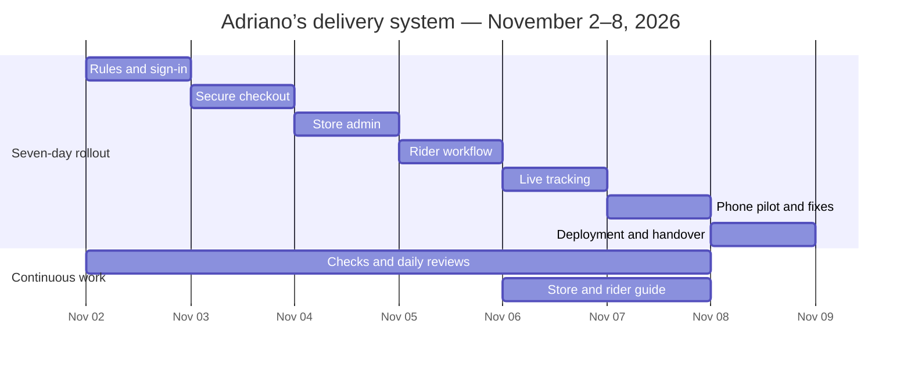

# Adriano’s one-week delivery-system roadmap

Planning baseline: **November 1, 2026**. Seven workdays: **Monday, November 2 through Sunday, November 8, 2026**, Asia/Manila. Target: a tested first release deployed on **November 8**. Today’s planning/setup is the starting point; tomorrow is Day 1.

**Workflow update:** the owner requests future implementation updates on GitHub `main` and Vercel **production**, with an extra branch only when crucial and a preview only when needed. Follow [PROJECT_WORKFLOW.md](PROJECT_WORKFLOW.md); this supersedes the earlier routine preview/feature-branch approach. Deployments before launch keep ordering closed.

This is a target schedule with daily acceptance checks. It assumes focused implementation sessions each day, owner decisions by Day 1, access to the provider accounts, and staff/phones available for the Day 6 pilot. A provider approval delay or unresolved critical failure changes the launch date; it does not justify opening an unsafe or unfinished checkout.

## Current progress

The three foundation gates are complete. **None of the seven remaining daily milestones has been completed yet.** Gate counts do not represent a percentage of development effort.

- Supabase, Vercel and GitHub are authenticated and linked. The tested setup is pushed on `main`.
- Real menu: 126 products and 170 priced choices, with the supplied shop pin stored.
- Database/RPC foundation: roles, RLS, trusted pricing, status transitions, idempotency and restricted GPS writes. Live anonymous order reads are denied. Supabase advisors have no warning-level findings.
- The production menu is deployed with ordering closed. Earlier browser checks verified Supabase-loaded prices, search, categories, size/flavor selection and a saved local bag. All 17 existing checks pass. All Vercel preview deployments have been removed.
- Ordering is closed and menu choices are inactive for checkout. Google customer sign-in, the checkout interface, staff screens, rider screens and live tracking are the remaining work.

Production menu: https://adrianosdelivers.vercel.app

Current roadmap status: [PROJECT_PROGRESS.md](PROJECT_PROGRESS.md). Editable status/evidence source: [PROJECT_TRACKER.json](PROJECT_TRACKER.json). Chart source: [PROJECT_GANTT.mmd](PROJECT_GANTT.mmd).

## Week-one launch scope

One branch; Adriano’s own riders; Google customer sign-in; pickup/delivery; cash collection; owner-approved fixed delivery fee and geographic coverage; manual rider assignment; customer order status; latest authorized foreground GPS; store opening/availability controls; a phone-tested release and operating guide.

The week-one backlog defers online payments, SMS/WhatsApp APIs, automatic dispatch, native mobile apps, multiple branches and road-distance/traffic ETAs. A custom domain can be added later. Browser GPS requires permission and can stop when the screen locks or the page moves into the background; the UI must show that limitation honestly.

## Critical decisions and schedule dependencies

1. **Business rules:** delivery area, fee, minimum order, opening hours, public contact, packaging, unavailable items and extra compatibility must be approved before checkout is finalized. The database’s current 5 km / PHP 35 defaults are provisional and must not silently become live policy.
2. **Google OAuth:** configure the provider, exact authorized website redirects and pilot users on Day 1. Confirm the intended audience and complete any provider requirements before public sign-up. An external verification delay remains a launch blocker; authorized test users can still support a private pilot. [Official setup guide](https://supabase.com/docs/guides/auth/social-sign-in/auth-google).
3. **Hosting:** the user’s free-budget requirement remains in force. Vercel Hobby restricts use to personal/non-commercial purposes. Record a resolution on Day 1: an eligible Vercel arrangement, or an owner-approved commercial-eligible free hosting alternative. A custom domain does not resolve plan eligibility, and this roadmap does not authorize a paid upgrade. If unresolved, Day 7 ends with a closed release candidate rather than live business ordering. [Vercel policy](https://vercel.com/docs/plans/hobby).
4. **Pilot availability:** reserve Day 6 now for the owner/admin, a rider, and two separate phones. Use designated test accounts and test orders; keep customer data out of screenshots and repository evidence.

Rules and test sign-in are on the checkout critical path. Hosting and public OAuth audience readiness must be resolved before public launch. If either remains blocked, continue independent implementation/testing and record the exact release blocker.

## Gantt chart

The schedule includes weekend work. Each primary row is one daily milestone; testing and daily review also happen as each feature is built.

<!-- gantt:start -->

<!-- gantt:end -->

## Day 1 — Monday, November 2: rules, access and sign-in

**Owner steps**

1. Supply the business answers using the form at the end of this document.
2. Confirm the owner/admin and rider identities. These are explicit role grants, never roles selected during customer sign-up.
3. Complete Google OAuth dashboard prompts with guidance. Enter the client secret only into the provider’s dashboard; never into chat or the browser bundle.
4. Record the commercial-hosting decision or the specific unresolved blocker.

**Implementation steps**

1. Record the approved rules and catalog corrections without enabling ordering.
2. Configure Google provider and exact redirect allowlists for the chosen test URL.
3. Test sign-in/sign-out with a customer and the authorized staff accounts.
4. Verify a customer cannot read staff data or grant themselves a role.

**Day-end result:** working test sign-in, approved checkout rules, authorized pilot identities, and a documented hosting/audience decision. Unresolved external launch dependencies stay visible on the tracker.

## Day 2 — Tuesday, November 3: trusted customer checkout

1. Build delivery/pickup selection, customer contact fields, manual address entry and a destination map pin. Request location only after an explicit user action.
2. Resolve catalog keys to trusted database IDs. Keep sizes, flavors and differently priced menu families distinct.
3. Implement approved packaging and item-to-extra relationships. Validate compatibility, substitutions, quantity and prices in the database; frontend-only extra pricing is insufficient.
4. Show the complete cash quote before confirmation. Pickup has no delivery fee; the server rejects destinations outside approved coverage.
5. Submit through the idempotent order RPC and show a receipt/status page. Support pending-order cancellation and the one-active-order rule.

**Owner review:** a designated test pickup and an in-area delivery. Check the exact totals and printed menu choices.

**Done when:** both orders persist with correct trusted totals and item snapshots; a double click does not create two orders; invalid pins/extras/prices fail; each customer sees only their own orders. Coverage is a geographic radius or explicitly approved zone, with no claim of driving distance.

## Day 3 — Wednesday, November 4: store admin

1. Build the protected queue for new/active orders and order details.
2. Add accept, preparing, ready, cancellation and authorized rider assignment actions.
3. Complete pickup handover from the admin screen. Capture the operational cancellation/failed-delivery information needed by the store.
4. Add menu availability and controlled store open/close behavior. Keep the publicly reachable store closed during development.
5. Check simultaneous updates and invalid state transitions; show useful status history.

**Owner review:** the actual store operator walks a test order through preparation and pickup/dispatch readiness.

**Done when:** only authorized admins can manage the queue, actions follow the approved lifecycle, sold-out items cannot be ordered, and closed-store checkout is denied by the server.

## Day 4 — Thursday, November 5: rider operations

1. Build the rider’s assigned active deliveries screen.
2. Show only the necessary customer/address details, destination link and cash to collect.
3. Allow the assigned rider to start a ready delivery and complete it after handover/cash confirmation.
4. Handle reassignment, cancellation and failed-delivery procedures with the store.
5. Verify two riders cannot see or alter each other’s deliveries. Completion removes rider access to customer details.

**Owner review:** at least one rider tests the complete screen on their actual phone and confirms the cash handover process.

**Done when:** the correct rider can complete the delivery, a second rider cannot access it, pickup never enters the rider dispatch flow, and the collected amount matches the confirmed order.

## Day 5 — Friday, November 6: latest GPS and customer tracking

1. Add explicit GPS start/stop controls for an active assigned dispatch. Allow same-origin geolocation in the deployed permissions policy only as required by the implemented flow.
2. Display the latest authorized position and update age, with required basemap attribution. Store one latest fix rather than route history.
3. Connect order-status/GPS updates with reconnection handling and manual-refresh/polling fallback. Respect free-tier quotas and the existing server write throttle.
4. Hide stale/inaccurate positions. Clearly indicate denied permission, interrupted/background tracking and unavailable signal.
5. Remove map/private state on stop-sharing, sign-out and order closure, alongside server-side cleanup.
6. Draft the short store/rider operating guide and privacy/support information.

**Owner review:** use separate rider/customer phones, including permission denial and a locked-screen test.

**Done when:** the intended customer/admin sees the latest assigned-rider fix, outsiders cannot, GPS interruptions are visible, and closed orders expose no live rider location. No invented road ETA or guarantee of background tracking.

## Day 6 — Saturday, November 7: pilot, security and fixes

Reserve **2–3 hours** with staff and phones. The implementation effort is separate from this owner-operated pilot.

1. Run one complete pickup and one complete delivery through customer → admin → rider → customer.
2. Test two customer accounts and two rider accounts for isolation. Test signed-out requests and customer attempts to invoke staff actions.
3. Test price/variant/extra tampering, out-of-area delivery, unavailable items, duplicate submission, closed store and invalid status changes.
4. Test cancellation before/after preparation, a failed delivery, reconnect, browser refresh, weak signal and GPS denial.
5. Fix critical/high-severity failures; rerun affected checks and the full order flow when the fix affects it.
6. Complete public contact/privacy information, data handling, cash reconciliation and store/rider instructions.
7. Prepare a specific release commit, backup/restore procedure and known rollback target.

**Done when:** the owner reviews a specific passing release candidate and there are no unresolved critical/high-severity issues affecting security, order integrity, totals or delivery completion. Cosmetic improvements can move to the later backlog.

## Day 7 — Sunday, November 8: final deployment and handover

1. Confirm the hosting arrangement permits business use, Google sign-in supports the intended audience, and the release checks below pass.
2. Freeze the reviewed commit. Verify migration history, approved environment variable names and the production destination. Keep secrets out of Git, screenshots and frontend bundles.
3. Capture the required schema/data backup and verify the restore procedure in an isolated test setting. Record the previous deployment for rollback; closing ordering is the immediate incident response.
4. Merge/release the reviewed source through the agreed GitHub workflow. Deploy to the approved production destination with ordering initially closed.
5. Configure exact final website/OAuth URLs, HTTPS, headers and provider settings; test them on the actual production address.
6. Run controlled sign-in, quote, pickup and delivery smoke checks. Enable only owner-approved menu choices and open ordering after the launch checks pass.
7. Monitor the first limited set of orders with staff available. Close ordering if a serious failure appears; use the recorded rollback procedure.
8. Hand over the final URL, operating instructions, role list, backup/rollback steps and later backlog.

**Done when:** the production URL works for the intended audience, real order flow passes, the store can operate it, and the owner has the operating guide. If a launch blocker remains, publish the release candidate with ordering closed and record the revised launch conditions/date.

## The working system we will follow

Use [PROJECT_TRACKER.json](PROJECT_TRACKER.json) as the editable status/evidence source. `PROJECT_PROGRESS.md` is the readable board; regenerate it and the chart with:

```sh
node scripts/project-progress.mjs
```

Status flow: **planned → in_progress → review → done**. Use **blocked** with a specific reason, required action, responsible person and affected date. A calendar date passing never completes a task.

At the start of each work session:

1. Read the tracker and latest actual project state.
2. Pick the next milestone and confirm its dependencies/owner inputs.
3. Work on one milestone at a time. Independent documentation or approved configuration work may continue while external input is pending.

For each finished feature:

1. Implement the smallest complete flow using the existing architecture.
2. Run meaningful checks for the change, plus the required test/build checks. Do not add UI-only fake success states for backend operations.
3. Reconcile the existing setup work into `main` for the first tested implementation release, then commit/push tested implementation updates to `main` and deploy Vercel production. Use an extra branch only when crucial and a preview only when needed. Record the exact URL and commit. Documentation-only updates do not need another app deployment.
4. Review the feature with the owner against its acceptance list.
5. Update status, evidence, failures and next action; regenerate the progress board.

At the end of the day, report five things: **completed IDs; preview/commit; checks passed/failed; blockers/owner actions; next milestone**. This is a working agreement, not an automatically scheduled reminder or background task.

The existing setup branch is `setup/menu-preview`; `main` is the default for future implementation updates. Production deployments can present the closed store while features are completed. Opening real orders remains gated by the Day 7 launch checks. Never merge a failing change, apply an unreviewed migration to another project, purchase a service automatically, or open ordering merely to meet a date.

## Final release checklist

- [ ] Hosting supports intended business use within the approved budget.
- [ ] Google sign-in/sign-out and exact production redirects work for the intended audience.
- [ ] Owner-approved admin/rider grants are correct; customer metadata cannot grant staff access.
- [ ] Menu, availability, extras, packaging, fees, coverage, hours and support contact are approved.
- [ ] Pickup and delivery pass from checkout through completion on actual phones.
- [ ] Server-side pricing, coverage, quantities and idempotency are tested.
- [ ] Customer/rider isolation and all privileged transitions are tested.
- [ ] GPS consent, freshness, interruption, stop-sharing and closure cleanup work.
- [ ] Cancellation, failed delivery, cash handling and reconnect behavior are understood.
- [ ] Security/performance advisors are reviewed; required automated tests/build pass.
- [ ] No private keys or customer data appear in code, logs, public files or screenshots.
- [ ] Production headers, HTTPS and expected public/protected access are verified.
- [ ] Backup/restore procedure, rollback target and emergency store-close procedure are ready.
- [ ] Owner reviews the specific release candidate and staff are available for launch checks.
- [ ] Final URL and operating guide are handed over; initial orders are monitored.

Supabase's [production checklist](https://supabase.com/docs/guides/deployment/going-into-prod) supports the security/advisor/readiness checks. This project checklist is tailored to the delivery workflow and does not claim certification.

## Owner answers needed for Day 1

```text
Delivery radius or allowed barangays:
Delivery fee:
Minimum order:
Opening days/hours and cutoff:
Public store contact number:
PHP 10 box: per meal / per order / optional:
Unavailable menu items or price corrections:
Unspecified serving sizes and sauce choices:
Drink-extra compatibility and oat-milk substitution rule:
Admin name/email:
Rider names/emails:
Test customer accounts and Day 6 pilot availability:
Cash collection / failed delivery / cancellation process:
Privacy/support contact and order-data retention decision:
Commercial hosting decision within the approved budget:
```

Do not put passwords, API secrets, verification codes or tokens into these files or chat. Provider secrets belong in the appropriate provider dashboard.
